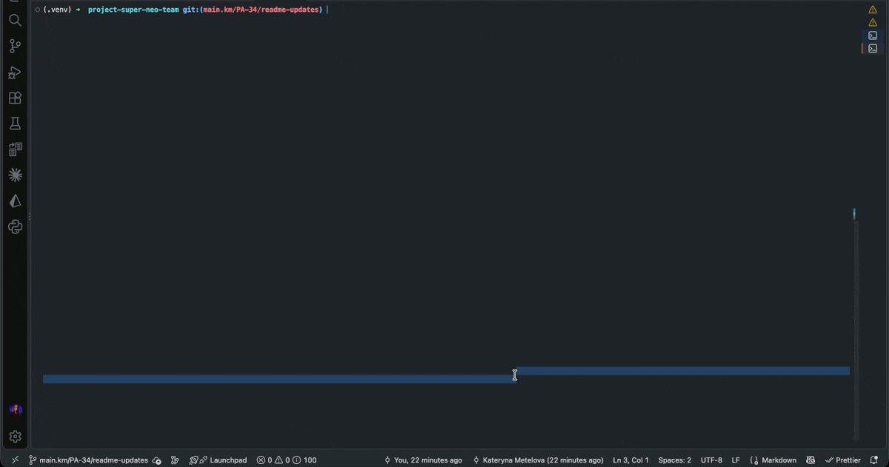

# Personal Assistant CLI

«Персональний помічник» — інтерактивний консольний застосунок на Python для зберігання контактів і нотаток. Він дає змогу вести контактну книгу з телефонами, email, адресами й днями народження, а також створювати нотатки, позначати їх тегами, шукати та переглядати їх у зручному порядку. Команди вводяться в терміналі; доступні підказки під час введення та довідка з прикладами. Дані зберігаються локально у JSON-файлах.



---

## 1. Про проєкт

Застосунок організовано як Python-пакет `assistant`. Інтерфейс командного рядка використовує `prompt_toolkit` для автодоповнення, а `Rich` — для форматованих таблиць і повідомлень. Якість коду можна перевіряти за допомогою Ruff і MyPy.

Усі дані автоматично зберігаються у JSON-файлах у домашній папці користувача:

| Операційна система | Контакти | Нотатки |
|---|---|---|
| Linux / macOS | `~/assistant_storage/address_book.json` | `~/assistant_storage/notebook.json` |
| Windows | `%USERPROFILE%\assistant_storage\address_book.json` | `%USERPROFILE%\assistant_storage\notebook.json` |

---

## 2. Вимоги

- Python версії **3.10 або новішої**.

Перевірити встановлену версію можна командою `python --version` (на macOS/Linux також `python3 --version`).

## 3. Як налаштувати та запустити

### Крок 1. Клонувати репозиторій та перейти в папку:
```bash
git clone https://github.com/Skayona/project-super-neo-team.git
cd project-super-neo-team
```

### Крок 2. Встановити та запустити

Оберіть свою операційну систему й інструмент встановлення. Команди `pip` створюють та активують віртуальне середовище. `uv sync` створює та синхронізує середовище проєкту автоматично.

| Операційна система | Через pip | Через uv |
|---|---|---|
| **Linux / macOS** | `python3 -m venv .venv`<br>`source .venv/bin/activate`<br>`python -m pip install --upgrade pip`<br>`python -m pip install -e ".[dev]"`<br>Запуск: `python -m assistant` | `uv sync --extra dev`<br>Запуск: `uv run python -m assistant` |
| **Windows (cmd)** | `python -m venv .venv`<br>`.venv\Scripts\activate.bat`<br>`python -m pip install --upgrade pip`<br>`python -m pip install -e ".[dev]"`<br>Запуск: `python -m assistant` | `uv sync --extra dev`<br>Запуск: `uv run python -m assistant` |

Встановлення з `.[dev]` додає пакет асистента, основні залежності та інструменти розробки `mypy` і `ruff`.

---

## 4. Команди

Вводьте команди в запущеному асистенті. Аргументи в кутових дужках у колонці «Формат» потрібно замінити власними значеннями; аргументи у квадратних дужках необов’язкові. Назви й текст із пробілами беріть у лапки.

### Загальні

| Команда | Призначення | Приклад |
|---|---|---|
| `hello` | Привітання з асистентом | `hello` |
| `help` | Показати всі команди або довідку про конкретну | `help` / `help add-contact` |
| `close` | Зберегти дані та завершити роботу | `close` |
| `exit` | Зберегти дані та завершити роботу (синонім `close`) | `exit` |

### Контакти

| Команда | Призначення | Приклад |
|---|---|---|
| `add-contact <ім’я> [телефон] [email] [ДД.ММ.РРРР] [адреса]` | Додати контакт або оновити наявний | `add-contact Anna 0501234567 anna@mail.com 15.03.1995 Київ` |
| `delete-contact <ім’я>` | Видалити контакт | `delete-contact Anna` |
| `find-contact <запит...>` | Знайти контакт за ім’ям або даними | `find-contact Anna` |
| `show-all-contacts` | Показати всі контакти | `show-all-contacts` |
| `add-phone <ім’я> <телефон>` | Додати телефон контакту | `add-phone Anna 0507654321` |
| `show-phone <ім’я>` | Показати інформацію та телефони контакту | `show-phone Anna` |
| `change-phone <ім’я> <старий_телефон> <новий_телефон>` | Замінити телефон контакту | `change-phone Anna 0501234567 0509998877` |
| `delete-phone <ім’я> <телефон>` | Видалити телефон контакту | `delete-phone Anna 0501234567` |
| `add-birthday <ім’я> <ДД.ММ.РРРР>` | Додати день народження | `add-birthday Anna 15.03.1995` |
| `show-birthday <ім’я>` | Показати день народження | `show-birthday Anna` |
| `change-birthday <ім’я> <ДД.ММ.РРРР>` | Змінити день народження | `change-birthday Anna 20.04.1996` |
| `delete-birthday <ім’я>` | Видалити день народження | `delete-birthday Anna` |
| `upcoming-birthdays [дні=7]` | Показати дні народження за вказаний період | `upcoming-birthdays 14` |
| `add-email <ім’я> <email>` | Додати email | `add-email Anna anna@mail.com` |
| `change-email <ім’я> <новий_email>` | Змінити email | `change-email Anna new@mail.com` |
| `delete-email <ім’я>` | Видалити email | `delete-email Anna` |
| `add-address <ім’я> <адреса...>` | Додати адресу | `add-address Anna Київ, вул. Хрещатик 1` |
| `change-address <ім’я> <нова_адреса...>` | Змінити адресу | `change-address Anna Львів, пл. Ринок 5` |
| `delete-address <ім’я>` | Видалити адресу | `delete-address Anna` |

### Нотатки

| Команда | Призначення | Приклад |
|---|---|---|
| `add-note <назва> [текст] [теги...]` | Створити нотатку з необов’язковим текстом і тегами | `add-note "Список покупок" "Молоко та хліб" #дім магазин` |
| `add-tag <назва> <тег1> [тег2 ...]` | Додати нотатці теги | `add-tag Покупки дім терміново` |
| `remove-tag <назва> <тег>` | Видалити тег із нотатки | `remove-tag Покупки терміново` |
| `find-tag <тег1> [тег2 ...] [--all]` | Знайти нотатки за тегами; `--all` вимагає збігу всіх | `find-tag дім робота --all` |
| `all-tags` | Показати теги та кількість нотаток із ними | `all-tags` |
| `show-note <назва>` | Показати нотатку | `show-note "Список покупок"` |
| `all-notes` | Показати всі нотатки | `all-notes` |
| `find-note <запит>` | Шукати нотатки за назвою, текстом або тегами | `find-note молоко` |
| `sort-notes [--group]` | Відсортувати нотатки за тегами або згрупувати їх | `sort-notes --group` |
| `edit-note <назва> <новий текст...>` | Замінити текст нотатки, зберігши теги | `edit-note "Список покупок" Молоко та хліб` |
| `rename-note <стара назва> <нова назва>` | Перейменувати нотатку | `rename-note "Список покупок" "Покупки"` |
| `delete-note <назва>` | Видалити нотатку | `delete-note "Список покупок"` |

## 5. Структура пакета

```text
assistant/
├── __main__.py       # запуск через python -m assistant
├── cli.py            # цикл CLI, розбір введення та виконання команд
├── contacts/         # контакти, адресна книга та команди контактів
├── notes/            # нотатки, теги та команди роботи з ними
├── general/          # загальні команди, довідка та вихід
├── core/             # спільні моделі команд, помилки та базові типи
├── context/          # завантаження і збереження стану асистента
├── storage/          # читання та запис JSON-файлів
└── ui/               # форматування виводу й автодоповнення
```

## 6. Як перевірити код (Quality Checks)

Для перевірки типів і якості коду перед комітом використовуються **mypy** та **ruff** (усі команди запускаються з кореневої папки репозиторію, де знаходиться `pyproject.toml`):

- **Перевірка типів (MyPy):**
  ```bash
  mypy assistant
  ```

- **Перевірка стилю коду та імпортів (Ruff):**
  ```bash
  ruff check assistant
  ```

- **Автоматичне виправлення простих помилок стилю:**
  ```bash
  ruff check --fix assistant
  ```

- **Запуск усіх перевірок разом:**
  ```bash
  mypy assistant && ruff check assistant
  ```

## 7. Команда та ролі

| Учасник | Ролі |
|---|---|
| [Антон](https://github.com/AntonZaiets) | Scrum Master, Dev |
| [Катерина](https://github.com/Skayona) | Team Lead, Dev |
| [Аріна](https://github.com/ArynaPatlakh) | Dev, QA |
| [Ангеліна](https://github.com/aniaks240-star) | Dev, QA |
